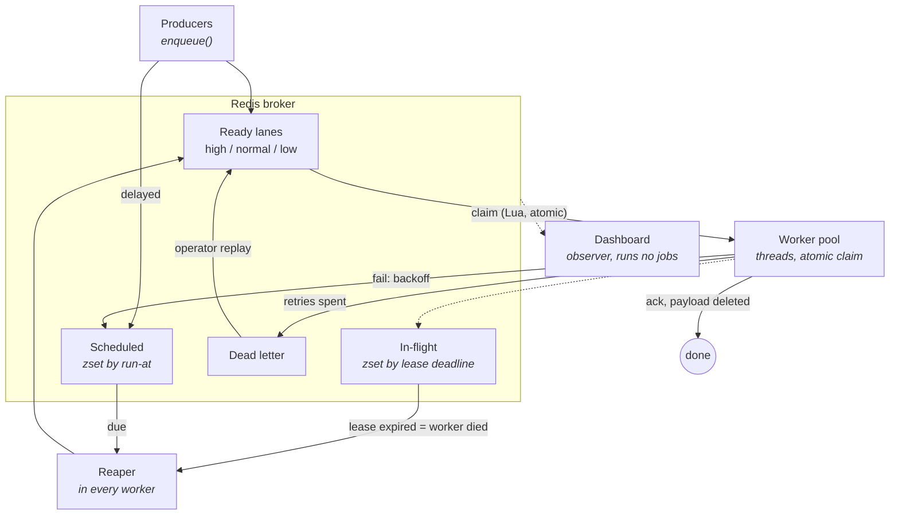

# taskq — a reliable distributed task queue (built from scratch)

A background job system in the spirit of Sidekiq / Celery, implemented from
first principles. The point of the project is the **reliability machinery** —
atomic job claim, crash recovery, retries with backoff, and a dead-letter
queue — written by hand rather than delegated to an existing job-queue library.

> Status: Stage 5 of 6 complete — tested, benchmarked, and proven under chaos. See [Roadmap](#roadmap).

**Verified:** zero job loss across 7 hard worker kills · 2,000 jobs/sec on a
laptop · 54 tests in CI. See [Benchmarks](#benchmarks--proof).

## Why this exists

Anyone can call an existing library's `enqueue()`. This project demonstrates the
harder thing: building the guarantees underneath it — that **once a job is
accepted, it runs to completion even if a worker is killed mid-execution.**

## Architecture



A job ID lives in exactly one structure at a time, and only atomic operations
move it between them. The claim (queue → in-flight) and every promotion back to
the lanes are Lua scripts precisely because a crash between two ordinary
commands would leave a job in nobody's hands — lost forever.

## Quickstart

Prerequisites: Docker Desktop, Python 3.11+.

```bash
# 1. start Redis
docker compose up -d

# 2. install dependencies
pip install -r requirements.txt

# 3. run the Stage 0 smoke test
python -m taskq.smoke
```

To run the test suite as well, install the dev dependencies:

```bash
pip install -r requirements-dev.txt
pytest
```

### Running jobs (Stage 1)

Two terminals — one worker, one producer:

```bash
# terminal 1: start a worker that waits for jobs
python -m taskq.worker

# terminal 2: enqueue a few demo jobs
python -m taskq.enqueue_demo
```

Or drain the queue once and exit (handy for a quick check):

```bash
python -m taskq.enqueue_demo
python -m taskq.worker --burst
```

## The reliability model (Stage 2)

The core guarantee: **once a job is accepted, it runs to completion even if
its worker is hard-killed mid-execution** (at-least-once delivery).

A job id lives in exactly one structure at a time; atomic operations move it:

| Redis key | Type | Holds |
|---|---|---|
| `taskq:queue:<name>:<prio>` | list | ready ids, one FIFO lane per priority (high/normal/low) |
| `taskq:inflight:<name>` | zset | claimed ids, scored by lease deadline |
| `taskq:scheduled:<name>` | zset | failed + delayed ids, scored by run-at time |
| `taskq:dead:<name>` | list | ids that exhausted their retry budget |
| `taskq:job:<id>` | hash | payload (`data`) + mutable `attempts`/`status`/`error`/`priority` |
| `taskq:idem:<key>` | string | active job id holding this idempotency slot (TTL'd) |
| `taskq:worker:<id>` | string | worker heartbeat info; liveness = key exists (TTL'd) |
| `taskq:metrics:<name>:*` | hash | fleet-wide counters, latency histogram, throughput buckets |

The mechanisms, each hand-written:

- **Atomic claim** ([claim.lua](taskq/scripts/claim.lua)) — pop + lease-record
  + attempt-count as one indivisible script, so there is no instant where a
  job is in nobody's hands. Attempts are counted **at claim time** (HINCRBY),
  so even a "poison pill" job that kills its worker has its runs counted and
  its retry budget enforced.
- **Visibility timeout + reaper** ([promote.lua](taskq/scripts/promote.lua),
  [reaper.py](taskq/reaper.py)) — a claimed job holds a lease; if the worker
  dies, the lease expires and any live worker's reaper thread atomically
  requeues it. No locks, no leader election: the promote script is atomic,
  so concurrent reapers are safe.
- **Retries with capped exponential backoff + jitter**
  ([retry.py](taskq/retry.py)) — failures retry at growing, randomized
  delays to avoid thundering-herd stampedes on a struggling dependency.
- **Dead-letter queue** ([broker.py](taskq/broker.py)) — a job that spends
  its retry budget is parked with its attempt count and last error intact:
  failure is data, not noise.
- **Graceful shutdown** — Ctrl+C stops claiming, finishes the current job,
  then exits. A hard kill is survivable by design.

Prove it end-to-end (spawns real workers, hard-kills one mid-job, checks a
permanently-failing job reaches the DLQ):

```bash
python -m taskq.verify_stage2
```

## Scale & scheduling (Stage 3)

- **Concurrent workers** — `--concurrency N` runs N jobs in parallel per
  worker via a thread pool (I/O-bound jobs release the GIL; CPU-bound work
  scales with additional worker *processes* instead — both are supported and
  both are safe, because claims are serialized by Redis itself).
- **Priority lanes** — each queue is three FIFO lists (`high`/`normal`/`low`);
  the claim script drains them in strict order, and recovery re-homes a job
  to *its own* lane (a rescued high-priority job is never demoted).
- **Delayed jobs** — `enqueue(job, delay_seconds=…)` / `run_at=…` parks the
  job in the scheduled zset; the reaper's promote pass delivers it when due
  (the same machinery retries already use).
- **Idempotency keys** — `Job(idempotency_key=…)`: while a job with that key
  is active, duplicate enqueues are suppressed and return the existing job's
  id. The slot is released on terminal states (success/dead) via an atomic
  compare-and-delete ([release.lua](taskq/scripts/release.lua) — the same
  pattern as safe distributed-lock release), and TTL-bounded so a crashed
  producer can't jam the slot forever.
- **Worker heartbeats** — every worker maintains a TTL'd presence key;
  liveness is simply "the key exists", so dead workers clean up after
  themselves by expiring.

Prove it (contention exactly-once, 1-vs-8 throughput, priority ordering,
delayed delivery, idempotent dedup):

```bash
python -m taskq.verify_stage3
```

## Observability (Stage 4)

A live dashboard at `http://127.0.0.1:8000` showing queue depth per priority
lane, in-flight and scheduled counts, throughput over time, execution-time
stats, the worker registry, and the dead-letter queue with **replay** and
**discard** controls.

```bash
python -m taskq.demo_seed --reset     # optional: seed a realistic mix
python -m taskq.worker --concurrency 4
python -m taskq.api                   # then open http://127.0.0.1:8000
```

- **Metrics live in Redis, not in the worker process.** Client libraries
  keep counters in process memory, so with a fleet of workers every counter
  describes one worker, scrapes hit a random one, and restarts reset them.
  Aggregating in Redis ([metrics.py](taskq/metrics.py)) gives one fleet-wide
  truth that survives restarts, and `HINCRBY` makes concurrent updates safe.
- **Execution time** is tracked as a cumulative histogram (Prometheus-style
  buckets) so a p95 can be estimated without storing every observation.
- **Throughput** is bucketed into 5-second slots with a TTL, so chart
  history evicts itself — no cleanup job.
- **`GET /metrics`** exposes standard Prometheus exposition format, written
  by hand — the format is plain text, so a client library would only add a
  dependency and reintroduce the per-process problem above.
- **Dead-letter replay** ([replay.lua](taskq/scripts/replay.lua)) returns a
  job to its own priority lane with a fresh retry budget. `LREM` acts as an
  atomic gate, so two operators double-clicking replay cannot requeue the
  same job twice.
- **The dashboard runs no jobs.** It is a pure observer, so it can be
  restarted, scaled, or killed without touching job processing.

Prove it (metrics accuracy, page render, Prometheus format, replay round
trip, double-click safety):

```bash
python -m taskq.verify_stage4
```

## Benchmarks & proof

All figures measured on a Windows laptop against Redis 7 in Docker, with the
`noop` task so the numbers describe the queue's own overhead rather than the
work a handler does. Reproduce them with the commands below.

### Throughput

```bash
python -m taskq.loadtest --jobs 10000 --workers 4 --concurrency 8
```

| Measure | Result |
|---|---|
| Jobs processed | **2,047 jobs/sec** (10,000 jobs in 4.88 s) |
| Jobs enqueued | 742 jobs/sec (10,000 jobs in 13.48 s) |
| Jobs unaccounted for | 0 |
| Concurrency speedup | **6.1×** at 8 threads vs 1 (I/O-bound tasks) |

The interesting result is that **enqueue is slower than processing.** Each
`enqueue()` is one synchronous round-trip from a single-threaded producer, while
32 worker threads consume in parallel. The producer, not the queue, is the
bottleneck — batching enqueues into a pipeline is the obvious next optimisation.

### Chaos: does it actually lose jobs?

```bash
python -m taskq.chaostest --jobs 600 --workers 4 --kills 10
```

Workers are hard-killed at random (`SIGKILL` / `TerminateProcess` — no graceful
shutdown, no cleanup) while the queue drains. Each job increments its own
counter, so afterwards every counter existing proves nothing was lost, and any
counter above 1 is a duplicate execution.

```
  workers killed         : 7
  jobs completed         : 600/600
  JOBS LOST              : 0
  jobs run more than once: 0
  dead-lettered          : 0

PASS - zero job loss across 7 hard worker kills.
```

Duplicates are **not** failures here. This system provides at-least-once
delivery: if a worker dies after finishing the work but before acknowledging it,
the lease expires and the job runs again. The test measures how often that
happens (0–0.5% across runs) rather than pretending it cannot.

### Tests

```bash
pytest                       # 54 tests
```

- **Unit** — retry/backoff maths including jitter bounds, job serialization,
  the task registry, and histogram percentile estimation. No Redis needed.
- **Integration** — every broker state transition against a real Redis:
  claim, ack, retry, burial, lease recovery, priority routing, delayed jobs,
  idempotency lifecycle, replay, and discard.
- **Concurrency** — the tests that would fail if the Lua scripts were ordinary
  command sequences: 20 threads racing to claim one job (exactly one wins),
  50 jobs against 50 threads with no duplicates or losses, concurrent reapers
  that must not double-requeue, and simultaneous replay clicks.

Every test runs in its own Redis namespace, so the suite is safe to run against
a developer's local instance and never touches real queues.

[CI](.github/workflows/ci.yml) runs the suite on Python 3.11/3.12/3.13 against a
Redis service container, then runs the stage verifications, the chaos test, and
a smaller load test — so a regression in crash recovery fails the build.

## Project layout

```
reliable-task-queue/
├── docker-compose.yml      # local Redis broker
├── requirements.txt
├── .env.example            # configurable env vars (defaults match docker)
└── taskq/
    ├── config.py           # environment-driven config (incl. reliability knobs)
    ├── job.py              # the Job model + JSON serialization
    ├── redis_client.py     # Redis connection factory
    ├── registry.py         # @task decorator + name -> handler lookup
    ├── queue.py            # producer-facing API (enqueue/size)
    ├── broker.py           # ALL job state transitions: claim/ack/fail/bury/recover
    ├── scripts/
    │   ├── claim.lua       # atomic pop + lease + attempt-count (the heart)
    │   └── promote.lua     # atomic "move due ids from zset to queue"
    │   └── replay.lua      # atomic dead-letter replay (LREM as the gate)
    ├── retry.py            # capped exponential backoff + jitter
    ├── reaper.py           # recovery thread: expired leases + due retries/delays
    ├── heartbeat.py        # worker presence via TTL'd keys
    ├── metrics.py          # fleet-wide counters/histogram/throughput in Redis
    ├── worker.py           # the worker loop (thread-pool concurrency)
    ├── api.py              # FastAPI dashboard + JSON API + /metrics
    ├── static/
    │   └── dashboard.html  # self-contained live dashboard (no CDN)
    ├── example_tasks.py    # demo tasks
    ├── enqueue_demo.py     # demo producer
    ├── demo_seed.py        # seeds a realistic mix for the dashboard
    ├── smoke.py            # Stage 0 verification
    ├── loadtest.py         # throughput harness
    ├── chaostest.py        # kills workers at random, asserts zero loss
    ├── verify_stage2.py    # Stage 2 proof: crash recovery + DLQ, automated
    ├── verify_stage3.py    # Stage 3 proof: contention/throughput/priority/delay/idem
    └── verify_stage4.py    # Stage 4 proof: metrics/dashboard/prometheus/replay

tests/                      # 54 unit, integration, and concurrency tests
.github/workflows/ci.yml    # tests + reliability proofs on every push
```

## Roadmap

- [x] **Stage 0 — Foundation:** project scaffolding, Redis via Docker, Job model, smoke test.
- [x] **Stage 1 — MVP happy path:** `@task` registry, `enqueue()` onto a Redis list, single worker that runs jobs.
- [x] **Stage 2 — Reliability core:** atomic claim (Lua), lease + reaper crash recovery, retries with backoff + jitter, dead-letter queue, automated chaos verification.
- [x] **Stage 3 — Scale & scheduling:** thread-pool concurrency, strict priority lanes, delayed jobs, idempotency keys, worker heartbeats.
- [x] **Stage 4 — Observability:** Redis-aggregated metrics, live web dashboard, Prometheus endpoint, dead-letter replay.
- [x] **Stage 5 — Proof & polish:** 54 tests, load test, chaos test, CI, benchmarks.
- [ ] **Stage 6 — Distributed (stretch):** multi-node workers.

## Known limitations

Documented deliberately — these are the trade-offs made, not bugs to be
surprised by.

- **At-least-once, not exactly-once.** A worker that finishes the work and dies
  before acknowledging will have its job re-run. Exactly-once delivery is not
  achievable in a distributed system; the standard answer is at-least-once plus
  idempotent handlers. Measured duplicate rate under chaos: 0–0.5%.
- **The lease is static.** A job that runs longer than `TQ_LEASE_SECONDS` has
  its lease expire while still working, so it will be executed twice. The fix is
  lease renewal — a worker extending its own lease as it runs. Heartbeats
  currently report worker presence only; they do not extend job leases.
- **Redis is a single point of failure.** No replication or failover. Append-only
  persistence is enabled, but the default sync policy can lose up to one second
  of writes on a hard crash. Production would want Sentinel or a managed cluster.
- **Not Redis Cluster safe.** The Lua scripts build key names internally, so the
  cluster router cannot know every key up front. Sharding by queue is the simpler
  path; hash tags are the alternative.
- **No authentication.** The dashboard exposes replay and discard to anyone who
  can reach the port, and Redis runs without a password. Both are acceptable for
  a local development stack and unshippable beyond it.
- **Strict priority can starve the low lane** under sustained high-priority load.
  Weighted dequeue would fix it.
- **No result backend.** Return values are discarded and payloads are deleted on
  success; jobs that need to report results write them somewhere themselves.
- **Job arguments are stored in plaintext** in Redis and shown in the dashboard's
  dead-letter view. Jobs carrying personal data should pass identifiers and
  re-fetch, or encrypt the sensitive fields before enqueueing.

## Design notes

Each notable trade-off is commented inline at the relevant code — the Lua
scripts in `taskq/scripts/` carry the most detail, since they are where the
reliability guarantees actually live.

## License

MIT
